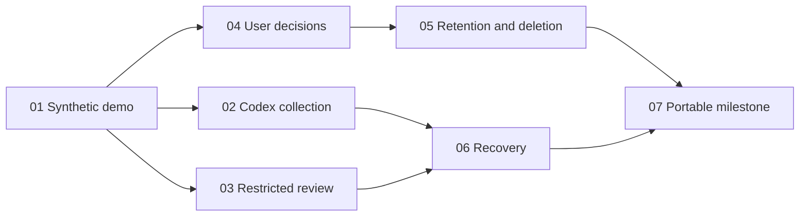

# Codex-only milestone

Seven approved tracer-bullet tickets implement the Codex-only milestone.
The expected range is **7–10 implementation PRs**, a review signal rather
than a cap. This documentation PR is not part of that implementation estimate.
Replan with the user before materially exceeding the accepted scope or range.

## Tickets and blocking edges

| Ticket | Blocked by | Execution |
| --- | --- | --- |
| [01: Demonstrate a Codex project becoming an attention item](issues/01-codex-attention-demo.md) | None | Complete — [verified synthetic evidence](../../docs/evidence-01.md) |
| [02: Collect actual Codex threads with visible coverage](issues/02-codex-collection-coverage.md) | 01 | Implemented; 22 tests and actual Linux modern/legacy reader paths verified; Mac gate unverified |
| [03: Assess unfinished outcomes through restricted OpenClaw review](issues/03-restricted-openclaw-review.md) | 01 | Implemented; 93 integrated tests and built-container containment verified; account/model gates unverified |
| [04: Make project decisions persist across reviews](issues/04-persistent-project-decisions.md) | 01 | Complete — lifecycle and archive/retention verified with 05 |
| [05: Expire and delete stored project information](issues/05-retention-and-deletion.md) | 04 | Complete — independent privacy, restore/crash, browser and retained-revision checks passed |
| [06: Keep monitoring reliable through backlog and interruptions](issues/06-monitoring-recovery.md) | 02, 03 | Complete — recovery and combined container acceptance verified |
| [07: Run the complete milestone from portable containers](issues/07-portable-container-milestone.md) | 05, 06 | Complete — 93 tests, container/browser journey, SMTP, restore and containment verified |

## First demo and frontier

Ticket 01 is the first complete, synthetic end-to-end demo and the only
ticket initially unblocked. Verify it before expanding work.

After 01, tickets 02, 03, and 04 have satisfied their ticket-level blockers.
They may proceed independently only when their interfaces are stable and
implementation ownership does not overlap. Then 05 follows 04, 06 follows
02 and 03, and 07 integrates the complete milestone after 05 and 06.

## Execution rules

- Each ticket is a complete user-visible behavior, not an isolated layer.
  Use the primary application acceptance boundary in the [spec](spec.md).
- `ready-for-agent` is a triage label. It does not mean blockers are complete
  or that implementation has started. Keep execution progress distinct.
- Work the frontier: start a ticket only after its listed code/decision
  blockers are verified complete. Credentials, actual account connections,
  real email recipients, and production Envoy configuration are separate
  activation gates, not ticket dependency edges.
- Maintain each work row's owner, state, and evidence during execution.
  Assignments remain inside the ticket; they do not create extra tickets or
  PRs automatically. Record confirmed branches, exclusively owned files, or
  blockers when useful rather than predicting paths now.
- Mark a work row verified only after checking its evidence. A verified
  checkpoint unblocks only the work that depends on it; a ticket completes
  only when all acceptance criteria are verified.
- A missing live compatibility/model check stays untested. It does not block
  implementing fixture-backed code, but cannot be used to claim live support
  or satisfy a criterion that requires live evidence.
- The final milestone must exercise combined decision, privacy, collection,
  review, and recovery behavior; earlier isolated demos do not replace it.
- All implementation stays in project-watchkeeper. Other providers,
  remote-server collection, and Electricpeak edits/activation are outside
  this breakdown.

## Review stack

The approved ticket graph remains unchanged. Code review dependencies are
01 → 02 → 04 → 03 → 06 → 05 → 07. This supplies intake exclusion
enforcement, policy persistence, and privacy cleanup of scheduler/digest state
in each reviewable slice. The approved execution graph is unchanged; the
coordinator combines verified branches for review without merging GitHub PRs. No implementation PR is automatically merged.

Current draft PRs: [01 / #2](https://github.com/junr03/project-watchkeeper/pull/2),
[02 / #3](https://github.com/junr03/project-watchkeeper/pull/3),
[04 / #4](https://github.com/junr03/project-watchkeeper/pull/4),
[03 / #5](https://github.com/junr03/project-watchkeeper/pull/5),
[05 / #6](https://github.com/junr03/project-watchkeeper/pull/6),
[06 / #7](https://github.com/junr03/project-watchkeeper/pull/7),
[07 / #8](https://github.com/junr03/project-watchkeeper/pull/8).
