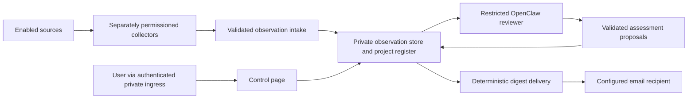

# Implementation guide

Status: Draft for consolidated review. The [specification](../.scratch/project-watchkeeper/spec.md)
is the source of truth for accepted behavior. Archive remains a proposal.
This guide describes the intended implementation, not a tested installation.

## First demonstration

Create a synthetic unfinished project, with source-shaped OpenCode and Codex
fixtures representing a server session and a Mac session. It has a concrete
next action for its user even though the last agent turn finished normally.
This is a fabricated test scenario, not an existing project of the owner.

Feed the fixtures through the collection/intake interfaces, identify the
outcome and next action, capture a digest in a local email sink, and persist
a user decision through the authenticated page. Simulate the Mac going
offline and returning with new observations. Repeat the review and show
retained visibility without a duplicate reminder.

Stub source transport, time/availability, and outbound email for repeatable
tests; exercise the real intake, register, policy, and notification logic.
Use controlled model responses for deterministic policy tests and evaluate
the actual reviewer separately on the synthetic cases. Stubs do not count as
proof of source-reader compatibility or semantic accuracy. The production
collectors remain part of the first slice and need separate compatibility
checks against pinned source versions and controlled test sessions.

All implementation and fixtures live in project-watchkeeper. Real account
connections, recipient delivery, and Electricpeak activation are separate
operator work, not requirements for this synthetic demonstration.

## Components and trust boundaries

Use a Compose application with independently constrained components where
credentials or privileges differ. Do not force every responsibility into one
process merely to provide a container deployment. Reuse OpenClaw for bounded
scheduled review and existing readers where they meet the contract; keep
collection, user decisions, and delivery independent of model availability.

- **Collectors** enumerate and read only enabled sources. Browser-session
  credentials stay with their collector. Local readers receive narrow
  transcript access, not the user's whole home directory. Source-side
  changes, prompts, and execution are unavailable through their interfaces.
- **Intake and store** validate provenance, size, identifiers, and revisions.
  Persist a source cursor only after its observations are durable.
- **Reviewer** reads selected evidence and submits structured proposals with
  source references, outcome, next action, reasoning, and uncertainty.
  It has no general shell, browser, account-write, or self-configuration
  capability. Its inference login is separate from source-account access.
- **Register service** validates proposals and applies deterministic user
  decision precedence. The model cannot undo completion, abandonment,
  exclusion, deletion, or a live snooze.
- **Delivery service** sends approved digest content to one configured
  recipient. The reviewer cannot select recipients or supply arbitrary
  outbound requests. Persist delivery outcomes independently of reviews.
- **Control page** shows projects, evidence, observation freshness, source
  coverage, uncertain proposals, and collection notices. Mutations require
  authenticated explicit actions and request-forgery protection.

Isolate the whole OpenClaw Gateway and its plugins, not only tool execution.
Use a non-privileged runtime, read-only configuration, narrow writable state,
no host-wide mounts, and no container-runtime socket. Enforce allowed network
destinations outside the model. Deny undeclared tools and plugins; fail closed
when the intended restrictions cannot be applied. Verify these properties
against the pinned OpenClaw release before connecting accounts.

## Source contract

Identify observations by source installation/account, thread, and message or
event identity; provider name alone is not unique. Record source timestamps,
capture times, revisions, retrieval limits, and evidence locations. Re-import
and overlapping pages must be idempotent; edited threads must be revisited.

Expose coverage and capabilities explicitly: listing, pagination, archived
history, message completeness, incremental changes, current execution status,
and usable thread links. A missing cursor or inaccessible archive is a
coverage limit. Lack of a live process signal is unknown, not idle.

Collect near the source while the device is awake and resume from durable
checkpoints. The server retains existing observations during laptop sleep.
A server collector operates independently of the laptop. Connectivity gaps
must not advance an inferred no-progress claim as though new evidence had
been collected.

Start with OpenCode's local server/session interfaces and Codex's documented
thread interfaces where available. Match each reader to the installed
version and real session source. If a reliable deep link is unavailable,
display an honest source/thread locator rather than fabricate a URL.

Consumer web readers are later adapters. Require explicit enablement,
version pinning, a read-only exposed interface, and visible reauthentication
or incomplete-history status. Authentication alone does not prove complete
history access.

## Review and durable state

Maintain project identity separately from thread identity. Preserve evidence
for grouping and let the user correct it. Review deltas and bounded backfill,
starting with recently updated threads, until the available backlog is
covered. Make per-run item, time, and inference limits configurable.

Apply the specification's attention thresholds to evidence of outcomes and
next actions. Keep source freshness, active work, external dependencies,
uncertain judgments, and user decisions distinct. A successful agent turn
and a completed project are different facts.

Checkpoint interruption and retry with bounded backoff. Quota exhaustion and
authentication failures must preserve prior state; there is no paid API
fallback. A failed review is not a successful review with zero findings.

Build a digest from changes since successful delivery. Deduplicate by the
meaningful finding and project, not just the run timestamp. A snooze expiry
permits reassessment and a renewed reminder. Empty unchanged reviews remain
silent. Use a durable outbox and delivery identifiers; account for ambiguous
email acceptance after a crash rather than claiming guaranteed exactly-once
delivery. Collection notices use a separate deduplication identity.

Treat raw transcript retention, retained project evidence, user decisions,
and notification records as separate categories. Deletion must also address
derived indexes/caches and pending notifications. Keep minimal content-free
exclusion identifiers to prevent re-import. Explain shared-thread effects
before confirmation. Define backup expiry and restore-time deletion replay;
do not promise that purging the live store instantly erases historical backups.

Archive, if accepted, is a separate reversible visibility/reminder choice.
It does not imply completion, abandonment, deletion, or unlimited retention.

## Configurable interfaces

Document and validate these settings before implementation is activated:

| Area | Configuration |
| --- | --- |
| Sources | Enabled adapters, installation IDs, source locations, exclusions, credential-file references |
| Collection | Polling, pagination/batch limits, retry policy, coverage reporting |
| Review | Schedule/time zone, work limits, subscription login state, evidence thresholds |
| Retention | Transcript expiry, evidence retention, deletion and backup policy |
| UI | Private base URL, authentication, trusted proxy/origin settings |
| Email | Transport, credential-file references, fixed sender/recipient, digest schedule |
| Runtime | State paths, UID/GID, health checks, image versions, allowed network destinations |

Ship public-safe examples and a configuration reference. Reject invalid
settings at startup. Keep actual account identities, recipient addresses,
credentials, transcripts, and deployment routes outside the repository.
Account credentials and local transport authentication may be needed, but
model API keys must not be a prerequisite.

## Delivery sequence

1. **Prove compatibility and containment.** Pin OpenClaw and reader versions.
   Build source-shaped fixtures and verify denied write/exec/account actions.
   Check actual reader compatibility using controlled test sessions; validate
   subscription-authenticated review when an explicitly configured test
   login is available. Report untested capabilities as untested.
2. **Complete the first slice.** Build both initial collectors, durable intake
   and project state, restricted review, the control page, and digest delivery.
   Include the complete acceptance checks below before claiming the slice.
3. **Package and hand off.** Produce portable container artifacts,
   configurable Compose examples, and the Electricpeak deployment contract
   in this repository. Document runtime requirements and operator checks.
   Electricpeak repository changes and production activation are separate
   work, outside this implementation plan.
4. **Expand one source at a time.** Add Claude, ChatGPT web, and Meta Muse
   readers only after the first demonstration. Each adapter must pass the
   same completeness, permission, and recovery contract.

These are outcome boundaries, not a mandated PR count. Keep changes reviewable
and preserve meaningful tests at each boundary. Revisit scope before
materially expanding the first demonstration. Do not generate implementation
tickets until the scope receives the final shared-understanding confirmation.

## Acceptance checks

| Scenario | Required result |
| --- | --- |
| Agent ends normally; outcome unfinished | Evidence-supported user next action is discoverable |
| Work spans both initial sources | One justified project or an explicit uncertain grouping proposal |
| Explicit unanswered request | Eligible for the next digest |
| Inferred stalled work | Requires configured elapsed time, usable evidence, and a concrete user action |
| Agent working / external dependency | Not reported as waiting on the user |
| Same evidence reviewed twice | No duplicate digest |
| User completes or abandons | Later model output cannot reopen it |
| Snooze expires | Reassess current evidence before notifying |
| Mac sleeps / wakes | Retain project visibility; report stale observations; resume without duplicates |
| Pagination limit / failed reader | Show partial coverage and separate collection notice |
| Quota or login interruption | Preserve state/checkpoint; resume; no API-key fallback |
| Retention and delete | Expire raw content; purge specified project data; prevent excluded re-import |
| Email preview follows link | No state change |
| Unauthenticated or direct UI access | Cannot read private project data or bypass authentication |
| Hostile instructions inside a transcript | Cannot change tools, credentials, recipients, or source accounts |
| Restart during intake or delivery | Recover checkpoints/outbox without losing user decisions |
| Archive and restore, if accepted | Suppress reminders reversibly without overriding lifecycle or retention |

Use deterministic fixtures for policy and recovery assertions. Evaluate model
judgment on representative cases, including false-positive traps; do not
claim that schema validation proves semantic accuracy. Test the container,
application-authentication, and proxy contracts in this repository's test
environment. The later deployment owner must verify the actual Envoy and
private-network boundary before connecting real accounts.
